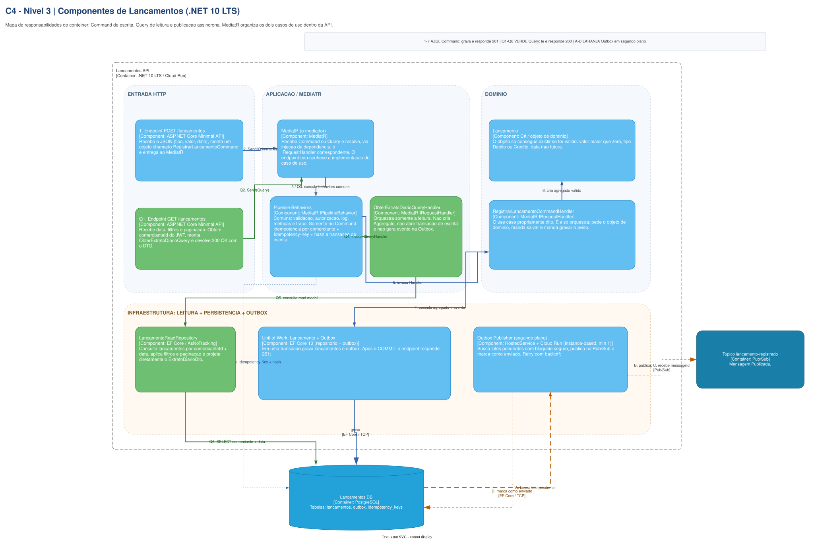
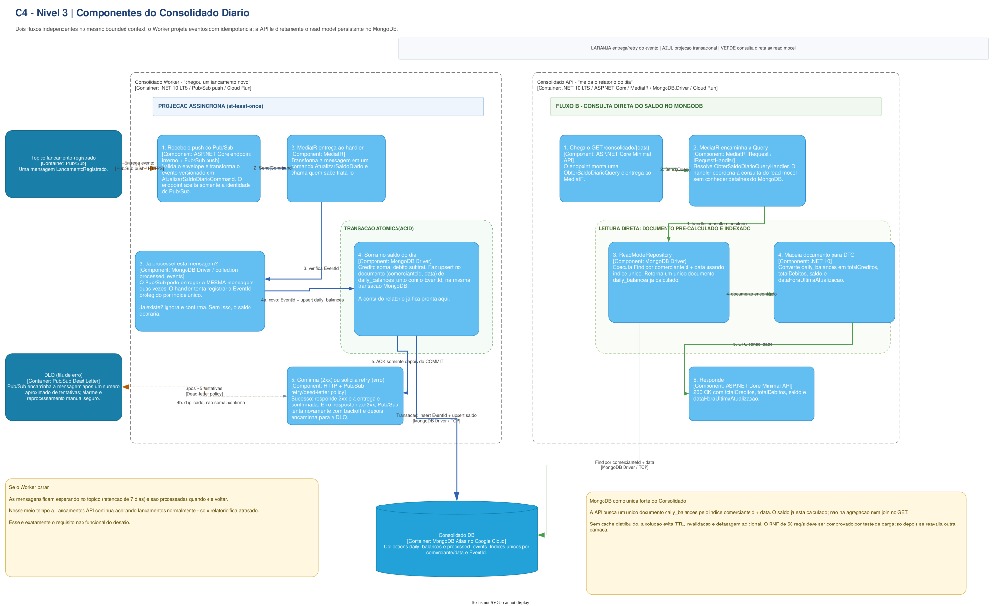

# C4 N3 - Components

O nível 3 detalha os componentes internos dos dois domínios. MediatR organiza os casos de uso dentro
de cada processo; Pub/Sub é responsável pelo desacoplamento entre Lançamentos e Consolidado.

## Lançamentos

O fluxo azul mostra o `RegistrarLancamentoCommand`, o verde mostra a
`ObterExtratoDiarioQuery` e o laranja mostra o HostedService que publica itens pendentes da
Outbox. Command e Query compartilham MediatR e os Behaviors comuns; somente o Command utiliza
idempotência de escrita, Aggregate, Unit of Work e Outbox.

## Consolidado

O Worker deduplica eventos e atualiza o documento diário. A API consulta diretamente o read model
indexado no MongoDB.

**Fonte editável:** páginas `3. C4 N3 - Dentro da Lancamentos API` e
`4. C4 N3 - Dentro do Consolidado` do
[`Draw.io principal`](../../../arquitetura-fluxo-de-caixa-c4.drawio).

[Voltar ao modelo C4](../README.md)
