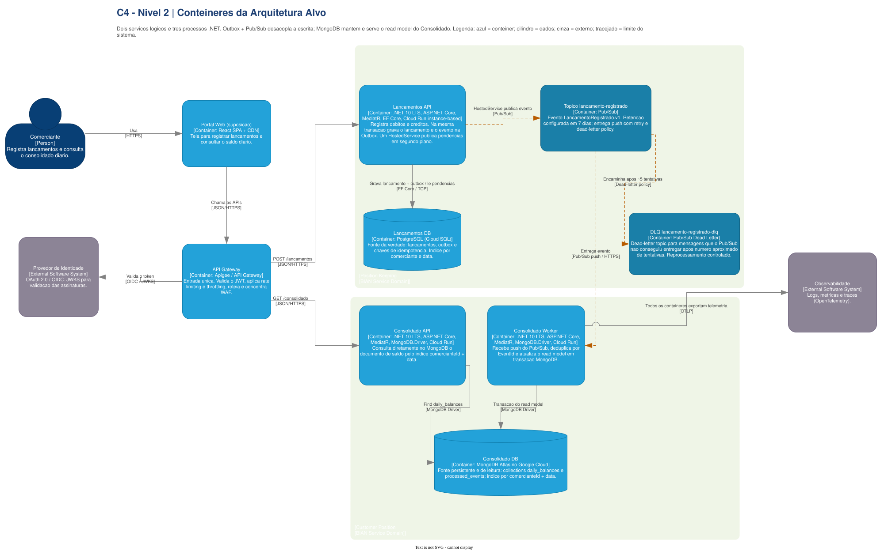

# C4 N2 - Containers

Mostra APIs, Worker, bancos e mensageria, além dos protocolos entre eles. O fluxo crítico confirma
o lançamento no PostgreSQL com Outbox; a consolidação ocorre depois por Pub/Sub e mantém seu read
model no MongoDB.

**Fonte editável:** página `2. C4 N2 - Conteineres` do
[`Draw.io principal`](../../../arquitetura-fluxo-de-caixa-c4.drawio).

[Voltar ao modelo C4](../README.md)
