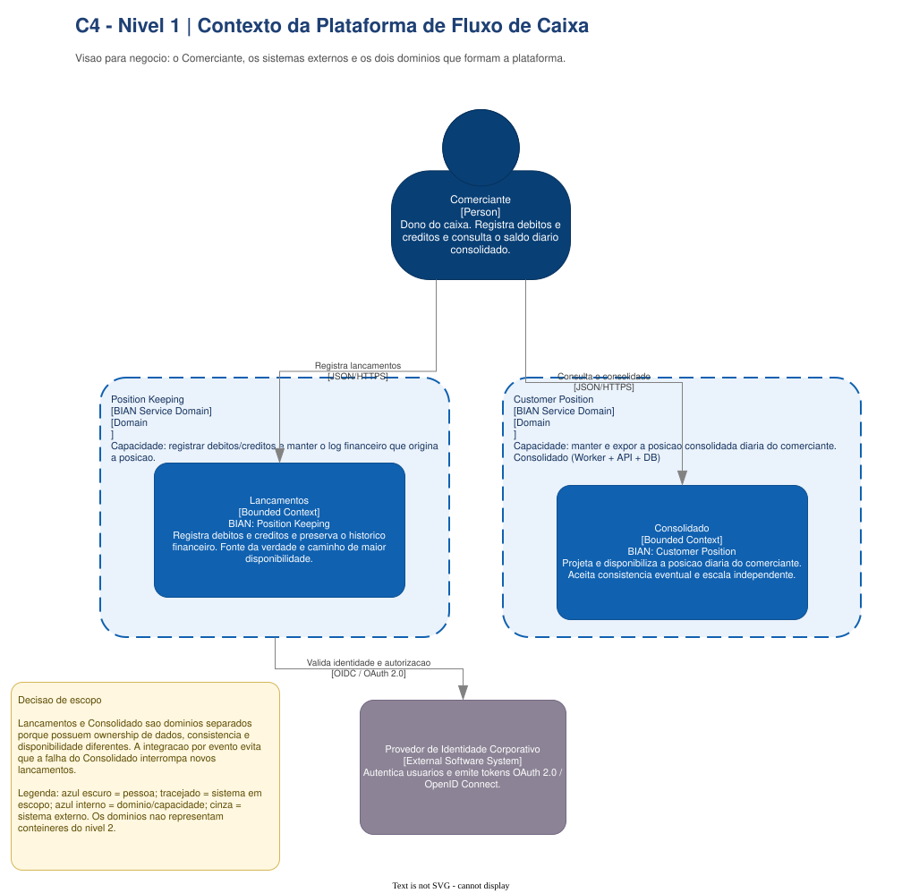

# C4 N1 - System Context

Apresenta o Comerciante como único ator, a fronteira da solução, os dois domínios e as dependências externas. É o ponto
de entrada para explicar por que Lançamentos e Consolidado têm ownership, disponibilidade e
consistência diferentes.

**Fonte editável:** página `1. C4 N1 - Contexto` do
[`Draw.io principal`](../../../arquitetura-fluxo-de-caixa-c4.drawio).

[Voltar ao modelo C4](../README.md)
