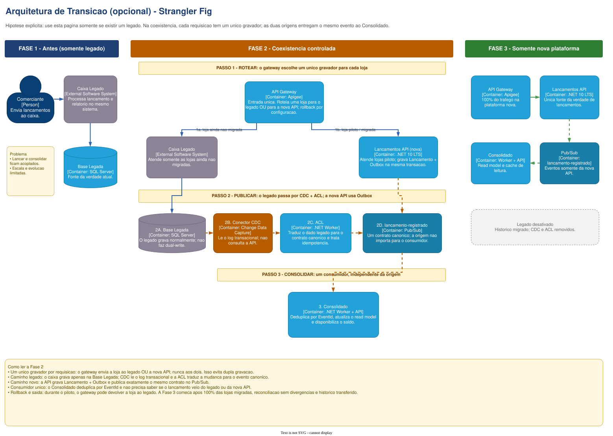

# Modernização do Legado

Esta seção é opcional e deve ser apresentada apenas se houver uma plataforma legada. A estratégia
usa Strangler Fig para migrar lojas gradualmente, mantendo um único gravador por requisição.

## Fases

1. **Somente legado:** caixa e consolidação ainda estão acoplados.
2. **Coexistência controlada:** o gateway direciona cada loja ao legado ou à nova API, nunca aos
   dois. Alterações do legado chegam ao contrato canônico por CDC e ACL; a nova API usa Outbox.
3. **Nova plataforma:** após migração, reconciliação e transferência do histórico, legado, CDC e
   ACL são removidos.

O Consolidado consome o mesmo evento canônico nas fases 2 e 3 e deduplica pelo `EventId`, sem
precisar conhecer a origem.

**Fonte editável:** página `6. Arquitetura de Transicao` do
[`Draw.io principal`](../../arquitetura-fluxo-de-caixa-c4.drawio).

[Voltar à documentação de arquitetura](../README.md)
