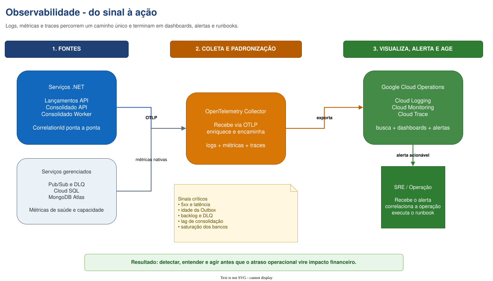

# Observabilidade

Esta visão mostra, de forma simples, como a solução transforma telemetria em ação operacional.
As aplicações não enviam alertas diretamente: elas produzem **logs, métricas e traces**, o
OpenTelemetry padroniza a coleta e o Google Cloud Operations permite visualizar, alertar e
investigar.

[Abrir a aba **7. Observabilidade** no Draw.io principal](../../arquitetura-fluxo-de-caixa-c4.drawio)

## Como ler o fluxo

1. As APIs e o Worker geram logs, métricas e traces e propagam `CorrelationId`, `EventId` e
   `IdempotencyKey`.
2. O OpenTelemetry Collector recebe os sinais via OTLP e os encaminha para a plataforma de
   observabilidade.
3. Cloud Logging, Cloud Monitoring e Cloud Trace centralizam pesquisa, dashboards e alertas.
4. O time de SRE/operação recebe alertas acionáveis e segue o runbook vinculado para diagnosticar,
   mitigar e escalar o incidente.

Os serviços gerenciados também fornecem métricas próprias. Pub/Sub/DLQ informa backlog e falhas de
entrega; Cloud SQL expõe conexões e saturação; MongoDB Atlas expõe latência, capacidade e saúde do
read model.

## Sinais mínimos

| Sinal | Por que importa |
|---|---|
| Disponibilidade, 5xx e p95/p99 das APIs | Detecta indisponibilidade e degradação para o usuário. |
| Idade do registro mais antigo da Outbox | Detecta falha ou lentidão na publicação. |
| Backlog, idade da assinatura e mensagens na DLQ | Detecta atraso ou falha no consumo. |
| Latência, conexões e saturação dos bancos | Antecipa gargalos de persistência. |

## Princípio operacional

Cada alerta deve apontar para um runbook com: impacto, verificações iniciais, mitigação, responsável
e critério de escalonamento. O diagrama demonstra o fluxo; os limites exatos dos alertas devem ser
calibrados por testes de carga e comportamento real da produção.

## Requisito relacionado

- [RNF 007 - Observabilidade e operação](../01-requirements/non-functional/RNF-007-observabilidade-e-operacao.md)

[Voltar ao índice de arquitetura](../README.md)
