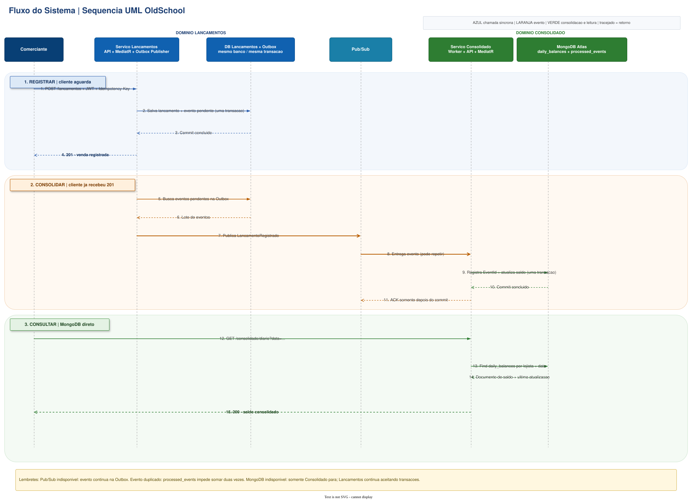

# Diagramas de sequência

O diagrama mostra o fluxo principal em três momentos: o lançamento é registrado com a Outbox na
mesma transação; o evento é publicado e consolidado de forma assíncrona; depois, o comerciante
consulta o saldo diário já calculado no MongoDB.

 Sequência UML Simplificada** do
[arquivo principal](../../arquitetura-fluxo-de-caixa-c4.drawio).

[Voltar ao índice de arquitetura](../README.md)
